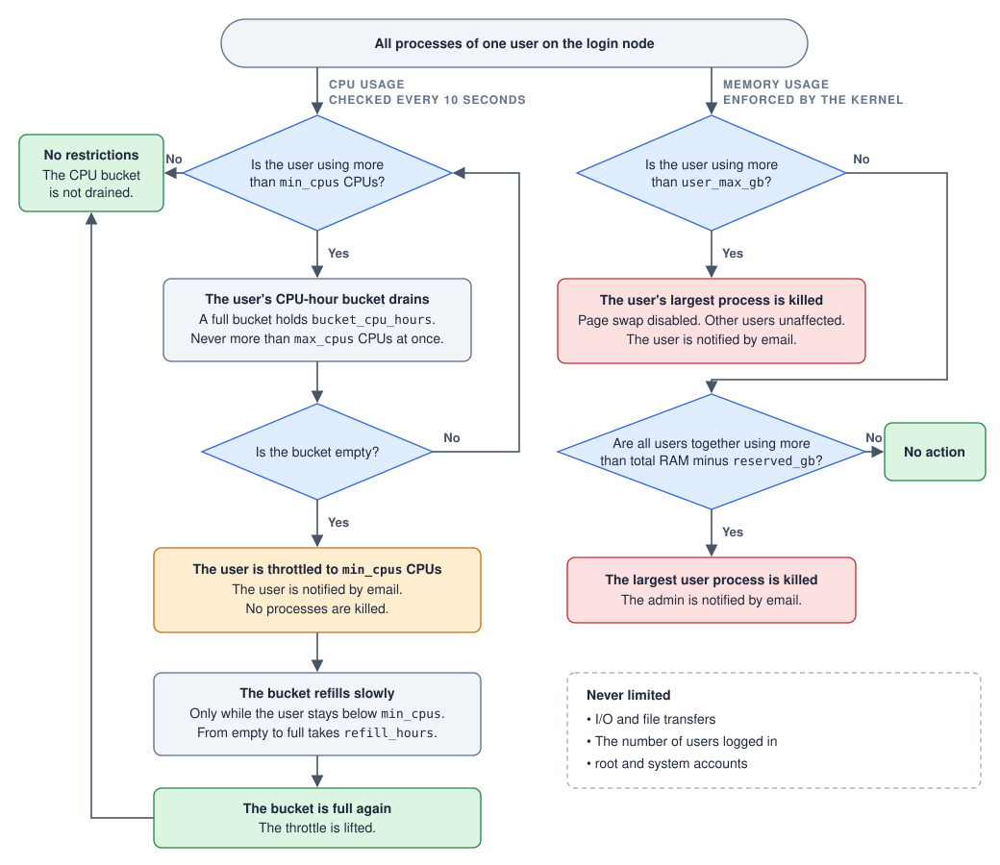

# frontendshepherd

`frontendshepherd` is a tool to automatically throttle and limit the resources (CPU+memory) available to users on shared frontend nodes in computing clusters. This prevents situations where one or a few users can block access for other users by either utilizing all CPU cores, or even worse crashing the node due to memory starvation. When users exceed limits they will be throttled and receive an email.

The total amount of memory available to all users is limited (by default 8GB is always available to the host), and a hard limit per user (by default 16GB) is also enforced, where processes will be killed if the limit is exceeded.

CPU load "buckets" are used to ensure that some burst load is always possible to allow for example software compilation and installation, building containers etc. The user bucket drains after a defined amount of CPU hours are used (by default 8 CPU hours) and the user's processes are then throttled to a bare minimum (by default 2 CPUs to enable longer `rsync` data transfers without also affecting the user's ability to still do work like coding on the frontend node). The throttle is lifted when the bucket has refilled completely (by default after 4 hours), and it only refills once the heavy processes have ended.

Long-running or stale processes matching a pattern (like `vscode-server` processes!) are automatically killed after a defined time (by default 7 days) to prevent unnecessary processes from accumulating over time.

`frontendshepherd` is completely independent from any specific workflow scheduling system (like SLURM or PBS, etc) and is thus compatible with any computing cluster.

`frontendshepherd` is designed to be as simple as possible ([KISS](https://en.wikipedia.org/wiki/KISS_principle)). One Python file, one config file, one systemd unit. Needs cgroup v2, systemd and Python 3.6 or later, nothing else.

## Configuration

All settings are in `/etc/frontendshepherd.conf` and are plain numbers of CPUs, hours and GB. Check that they fit the size of your node. Restart the service after changing anything: `systemctl restart frontendshepherd`.

The most important settings are listed here. The rest (mail server, the mail texts, exempt users, the pattern for stale processes, etc) are described in comments in the config file itself.

### CPUs
| Setting | Default | |
|---|---|---|
| `min_cpus` | `2` | Bare minimum CPUs. Using this much or less is never throttled or limited. It is also what a throttled user is limited to |
| `burst_cpus` | `8` | CPU burst ceiling. The most one user can use at any moment. Higher CPU utilization drains the user bucket faster |
| `bucket_cpu_hours` | `8` | CPU bucket. Any usage above the bare minimum is taken from the bucket. `8 CPUs` for 1 hour or `4 CPUs` for 2 hours empties it, and throttling kicks in |
| `refill_hours` | `4` | Time for an empty bucket to refill completely. It only refills while the user's CPU usage is below the bare minimum, so not while a throttled job is still running flat out. A throttled user is only released when the bucket is full again |

Note: A CPU is one hardware thread, as counted by `nproc` and `top`.

### Memory
| Setting | Default | |
|---|---|---|
| `user_max_gb` | `16` | Memory per user. Hard limit. Exceeding this limit kills that user's largest process. No page swap is ever allowed to prevent local storage filling up. |
| `reserved_gb` | `8` | Memory always unavailable to users to avoid exhausting the node |

### Stale or long-running processes
| Setting | Default | |
|---|---|---|
| `max_age_days` | `7` | Old VS Code servers and file watchers are terminated |

### Other
| Setting | Default | |
|---|---|---|
| `dry_run` | `true` in the installed config file | Only log what would happen. Limit nothing, kill nothing and send no mail |
| `address` | `{user}` | Where a user's mail goes, `{user}` is the login name. For example `{user}@example.org` |
| `admin` | `root` | Gets a copy when a user keeps hitting the limits, and a mail when the total memory limit is reached |

## Example
On a frontend node with 64 CPUs and 256GB memory the defaults give each user a ceiling of 8 CPUs and 16GB memory, and all users together can use at most 248GB.

A user running flat out at 8 CPUs is throttled after 1 hour, a user running 4 CPUs after 2 hours, and a user running 2 CPUs or less never.

Say a user starts a large `minimap2` mapping with 32 threads. It is held at 8 CPUs from the start, empties the bucket in 1 hour, and is then held at 2 CPUs. As long as it keeps running it uses those 2 CPUs fully, so the bucket stays empty and the user stays throttled, for days if need be. Only when the job has ended, or is killed, and the user's usage is below 2 CPUs does the bucket start to refill, and 4 hours later it is full and the throttle is lifted.

Users get an email when they are throttled or when a process is killed for memory, at most one of each per day. The admin is copied from the third time in a week. I/O is never limited and nothing is ever killed for using CPU. Root and system accounts are exempt.

There is no limit on the number of users logged in at once. Nothing is reserved per user, the limits are only ceilings, so the sum of all users' limits can be much larger than the node. The total memory limit for all users is what protects the node when many users are busy at the same time.

## Installation

As root, on each login node:

    ./install.sh

It starts in **dry-run mode**: it logs what it would do, but limits nothing and sends no mail. Then:

1. Watch `journalctl -u frontendshepherd` for a few days.
2. Edit `/etc/frontendshepherd.conf`, see [Configuration](#configuration). Set at least the mail `address` and `admin`, and `smtp_host` if you do not use the local sendmail. Check mail with `frontendshepherd testmail you@example.org`.
3. Set `dry_run = false` and run `systemctl restart frontendshepherd`.

## Usage

Any user can check their own allowance:

    $ frontendshepherd status
    alice on login1
      State       ok; at this rate the bucket is empty in about 56 min
      CPU in use  5.0 CPUs (up to 8 allowed, 2 are free of charge)
      CPU bucket  59% full (4.7 of 8 CPU-hours)
      Memory      3.1 of 16 GB
      Warnings    0 in the last 7 days

`frontendshepherd status --all` lists everyone (the default for root), and `frontendshepherd status alice` shows one user.

## How it works

Every login already runs in its own systemd cgroup, `user-UID.slice`. At startup the daemon writes the memory limits and the CPU ceiling as systemd drop-ins, which the kernel enforces even when the daemon is stopped. Every 10 seconds it reads each user's CPU counter, updates their bucket, and lowers or restores their CPU ceiling.

The CPU counter is the kernel's running total of CPU time used by all of the user's processes together. The difference between two readings, divided by the 10 seconds, is the user's average number of CPUs in that interval, so short spikes and dips are averaged out. Above the bare minimum the usage is taken from the bucket, below it the bucket refills, and right at it (within 5 %) nothing happens. The throttle goes on only when the bucket is completely empty and off only when it is completely full, so it can never flip back and forth quickly.

## Considerations

- Each login node keeps its own buckets.
- Files in `/dev/shm` count as the user's memory. File cache does not get anyone killed.
- Cron jobs are covered only if cron's PAM stack uses `pam_systemd` (the usual default). Check that they show up under the user's slice in `systemd-cgls`.
- Stopping the daemon lifts all throttles; the memory limits and CPU ceiling stay. Buckets survive restarts and reboots.
- Uninstall: disable the service, then `rm /etc/systemd/system/user*.slice.d/90-frontendshepherd.conf` and `systemctl daemon-reload`.

## Test

    python3 tests/test_shepherd.py
