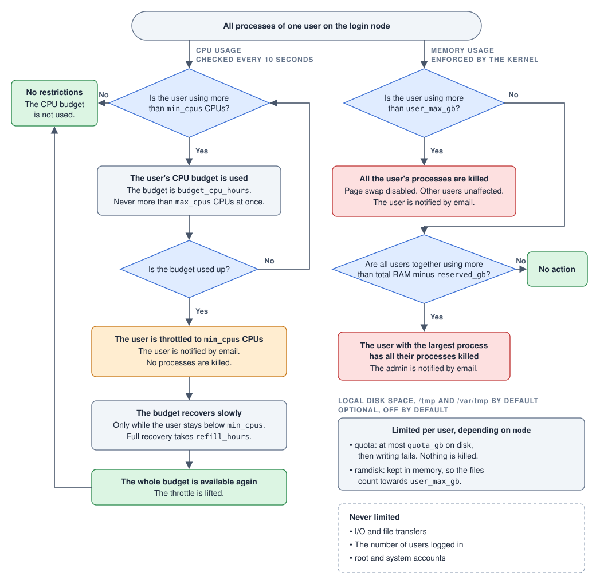

# frontendshepherd

`frontendshepherd` is a tool to automatically limit the resources (CPU and memory) available to each user on the shared frontend (aka access/login) nodes of a computing cluster to keep them responsive. It prevents situations where one or a few users block access for everyone else by running large computing jobs directly on a frontend node, accidentally or deliberately, instead of submitting them as batch jobs to the dedicated compute nodes. Such jobs can use all CPU cores or, even worse, crash the node due to memory starvation. Users who exceed the limits are restricted automatically and receive an email explaining why.

**Memory usage** is hard-limited per user (by default 16GB), where all of the user's processes on the node are killed if the limit is exceeded. The total amount of memory available to all users together is also limited (by default 8GB is always kept for the host), so the node itself can never run out.

**CPU usage** is limited both with a max number of available CPUs per user, but also by using a "budget" of CPU hours per user (by default 8 CPU hours), so that some burst load is always possible, for example for compiling and installing software, building containers, doing quick data analyses etc. When the budget is used up, the user's processes are throttled to a bare minimum (by default 2 CPUs), which is still enough for longer `rsync` data transfers and for normal work like coding on the frontend node. The throttle is lifted when the whole budget is available again (by default after 4 hours), and it only recovers while the user's average CPU usage is below the bare minimum.

**Local disk space** can optionally be limited per user too (off by default), by default in `/tmp` and `/var/tmp`, either with disk quotas or by making them ramdisks, where files count as the user's memory.

**Stale processes** are rounded up by the "sheepdog": processes matching a pattern (like `vscode-server` processes!) are automatically killed after running for a max walltime (by default 7 days) to prevent unnecessary processes from accumulating over time.

`frontendshepherd` only restricts users. No resources are reserved for individual users, they are only limited, so all users still share the whole node and any number of users can be logged in at once. 

`frontendshepherd` is designed to be as simple as possible ([KISS](https://en.wikipedia.org/wiki/KISS_principle)): one Python file, one config file, one systemd unit. Furthermore, it works completely independently from any specific workload scheduling system (like SLURM or PBS, etc) and is thus compatible with any computing cluster, or even useful in other scenarios where nodes are shared among many users.



## Configuration

All settings are in `/etc/frontendshepherd.conf` and are plain numbers of CPUs, hours and GB. Check that they fit the size of your node. Restart the service after changing anything: `systemctl restart frontendshepherd`.

The most important settings are listed here. The rest (mail server, the mail texts, exempt users, the pattern for stale processes, etc) are described in comments in the config file itself.

### CPUs
| Setting | Default | |
|---|---|---|
| `min_cpus` | `2` | The number of CPUs a user can use at any given moment without using their CPU budget. Usage at or below this is never throttled, and it is also used as the limit imposed on throttled users. |
| `max_cpus` | `8` | Max CPUs. The most one user can use at any moment, also for short bursts. Higher CPU utilization uses up the budget faster. |
| `budget_cpu_hours` | `8` | CPU budget per user in CPU hours. When a user uses more than `min_cpus`, the usage is charged to the budget (including the first `min_cpus`). When it is used up throttling kicks in. |
| `refill_hours` | `4` | Time for a used-up budget to be restored completely. It only recovers while the user's CPU usage is below the bare minimum, so not while a throttled job is still running flat out. A throttled user is only released when the whole budget is available again. |

Note: A CPU is one hardware thread, as counted by `nproc` and `top`. For example, a 32 core CPU with hyperthreading is thus equivalent to having 64 "CPUs" available.

### Memory
| Setting | Default | |
|---|---|---|
| `user_max_gb` | `16` | Memory per user. Hard limit. Exceeding this limit kills all of that user's processes on the node, and other users are not affected. No page swap is ever allowed to prevent local storage filling up. |
| `reserved_gb` | `8` | Memory always unavailable to users to avoid exhausting the node. |

### Local disk space
Off by default. The settings are in the `[disk]` section of the config file. By default only `/tmp` and `/var/tmp` are limited, but with `quota` any local directory users can write to can be added, for example a local `/scratch`.

| Setting | Default | |
|---|---|---|
| `mode` | `off` | `quota`: a disk quota per user. A user at the limit gets "Disk quota exceeded", nothing is killed. `ramdisk`: the paths are kept in memory (tmpfs), and files there count towards `user_max_gb`. A user who exceeds it is killed as for any other memory usage, and their files in the ramdisks are deleted. |
| `paths` | `/tmp /var/tmp` | The directories to limit. With `quota` each can have its own quota in GB, for example `/tmp:100 /var/tmp:20`. |
| `quota_gb` | `50` | With `quota`: max disk space per user for the paths without their own quota. |
| `ramdisk_gb` | `0` | With `ramdisk`: size of each ramdisk for all users together. `0` is half of the node's memory. |
| `reserved_gb` | empty | Disk space only root can use, so users together can never fill a disk completely. One number for all, or per path like `/tmp:20 /var/tmp:5`. Works in every `mode`, only on ext4. Empty leaves the disks as they are. |

A quota applies to a whole filesystem, not only to the directory, so it also covers everything else the user has on it. For example with `/var/tmp` on the `/var` filesystem, also the user's mail in `/var/mail`. If two paths are on the same filesystem, they share one quota, the largest of the two.

With `quota`, the `quota` package (`setquota`) must be installed and user quotas must be enabled on the filesystems where the paths are located. `frontendshepherd` and `install.sh` do neither, they never touch `/etc/fstab` or mounts. Until quotas are enabled nothing is limited, and the daemon logs a warning saying what to do. A user gets the quota the first time they access the node. Enabling user quotas is done once per filesystem, here for `/tmp`:

- ext4: add `usrquota` to the mount options in `/etc/fstab` and check it with `findmnt --verify`. Then apply it, create the quota file and switch quotas on: `mount -o remount /tmp && quotacheck -cum /tmp && quotaon -u /tmp`. A reboot alone does not create the quota file, but once it exists, quotas are switched on again at every boot.
- XFS: add `uquota` to the mount options in `/etc/fstab`, then unmount and mount it again (a remount is not enough). For the root filesystem add `rootflags=uquota` to the kernel command line and reboot instead.
- Restart `frontendshepherd` afterwards: it stops trying a filesystem without quotas until it is restarted.
- Check with `quotaon -pu /tmp`, also after the next reboot, and see everyone's usage with `repquota -s /tmp`. Users can see their own with `quota -s`.

With `ramdisk`, the paths only become ramdisks at the next reboot, nothing is mounted on a running node. Everything in them is lost at every reboot, also in `/var/tmp`. If a path is already present in `/etc/fstab`, the ramdisk is mounted there instead and that filesystem is no longer used.

### Stale or long-running processes
These are handled by the "sheepdog", and its settings are in the `[sheepdog]` section of the config file.

| Setting | Default | |
|---|---|---|
| `patterns` | `\.vscode-server/` | Which processes count as stale: regular expressions matched against the full command line, separated by spaces. The default matches VS Code servers and their file watchers. |
| `max_age_days` | `7` | User processes matching a pattern are terminated after running for this long. |

### Other
| Setting | Default | |
|---|---|---|
| `dry_run` | `true` in the installed config file | Only log what would happen. Limit nothing, kill nothing and send no mail. |
| `address` | `{user}` | Where a user's mail goes, `{user}` is the login name. For example `{user}@example.org`. |
| `admin` | `root` | Gets a mail when all users together reach the total memory limit of the node. Not notified when a single user reaches a limit. |

## Example
On a frontend node with 64 CPUs and 256GB memory the defaults give each user a ceiling of 8 CPUs and 16GB memory, and all users together can use at most 248GB.

A user fully utilizing 8 CPUs is throttled after 1 hour, and if only 4 CPUs then after 2 hours, and so on. A user utilizing 2 CPUs or less will never be throttled.

Say a user accidentally starts a large `minimap2` mapping with 32 threads for several days on a frontend node. It is limited at 8 CPUs from the start, uses up the budget in 1 hour, and is then held at maximum 2 CPUs thereafter. As long as it keeps running it uses those 2 CPUs fully, so the budget stays used up and the user stays throttled, for days if need be. Only when the job has ended, or is killed, and the user's usage is below 2 CPUs does the budget start to recover, and 4 hours later it is fully restored and the throttle is lifted. If the process ever exceeds the max memory limit it will be killed. In both cases the user receives an email about it being throttled or killed.

## Requirements

- Linux with cgroup v2 (the default on all current distributions)
- Only for disk quotas (off by default): the `quota` package and user quotas enabled on the filesystems
- systemd
- Python 3.6 or later, no extra packages

## Installation

As root, on each frontend node:

    ./install.sh

It starts in **dry-run mode**: it logs what it would do, but limits nothing and sends no mail. Then:

1. Watch `journalctl -u frontendshepherd` for a few days.
2. Edit `/etc/frontendshepherd.conf`, see [Configuration](#configuration). Set at least the mail `address` and `admin`, and `smtp_host` if you do not use the local sendmail. Check mail with `frontendshepherd testmail you@example.org`.
3. Set `dry_run = false` and run `systemctl restart frontendshepherd`.
4. Optional: to limit local disk space with disk quotas, enable user quotas on the filesystems first, see [Local disk space](#local-disk-space), then set `mode = quota` under `[disk]` and restart.

## Usage

Any user can check their own allowance:

    $ frontendshepherd status
    alice on login1
      State          ok; at this rate your CPU budget is used up in about 56 min
      CPU in use     5.0 CPUs (up to 8 allowed, 2 are free of charge)
      CPU budget     41% used (3.3 of 8 CPU-hours)
      Memory         3.1 of 16 GB
      Disk /tmp      12.4 of 50 GB used, 480 GB free on the disk
      Disk /var/tmp  0.1 of 10 GB used, 31 GB free on the disk
      Warnings       0 in the last 7 days

Users can only see their own status. As root, `frontendshepherd status` lists everyone and `frontendshepherd status alice` shows one user.

Admins can give a user their whole budget back and lift the throttle right away with `frontendshepherd reset alice`. Regular users can only run `frontendshepherd status`, the other commands (`run`, `reset` and `testmail`) are only available to root.

Everything the daemon does is logged to the systemd journal: every throttle, release, reset, process killed for memory and stale process terminated, with user and time. View it with `journalctl -u frontendshepherd`.

For an overview over time, `frontendshepherd stats` (root only) shows how many times users were throttled, killed for memory, reached their disk quota and had stale processes stopped, and how often the filesystem of one of the disk paths ran full (less than 1% left), in total, per week and for the users with the most events. By default for the last 90 days, use `--days` to change it. Full filesystems are recorded in every `[disk]` mode, also `off`, and disk quotas only with `quota`. The events are kept for a year (`history_days`) in `/var/lib/frontendshepherd/history.jsonl`, one JSON line per event, and each node keeps its own:

    $ sudo frontendshepherd stats --days 30
    Events on bio-fe01 in the last 30 days (since 2026-10-14)

                                  TIMES  USERS
    CPU throttled                    22      9
    killed, user memory limit         2      2
    killed, total memory limit        0      0
    reached the disk quota            3      2
    local disk full                   0      -
    stale process stopped             9      3
    reset by an admin                 1      1

    WEEK              THROTTLED  MEMORY  TOTAL  QUOTA  DISKFULL  SHEEPDOG  RESET
    2026-W42                  1       1      0      1         0         2      0
    ...

    USER (top 10)     THROTTLED  MEMORY  TOTAL  QUOTA  SHEEPDOG  RESET
    alice                    13       0      0      2         4      1
    ...

## How it works

Every login already runs in its own systemd cgroup, `user-UID.slice`. At startup the daemon writes the memory limits and the CPU ceiling as systemd drop-ins, which the kernel enforces even when the daemon is stopped. Every 10 seconds it reads each user's CPU counter, updates their CPU budget, and lowers or restores their CPU ceiling.

The CPU counter is the kernel's running total of CPU time used by all of the user's processes together. The difference between two readings, divided by the 10 seconds, is the user's average number of CPUs in that interval, so short spikes and dips are averaged out. Above the bare minimum all of the usage is charged to the budget (not only the part above the bare minimum), below it the budget recovers, and right at it (within 5 %) nothing happens. The throttle goes on only when the budget is completely used up and off only when all of it is available again, so it can never flip back and forth quickly.

Users get an email when they are throttled or when their processes are killed for exceeding the memory limit, every time it happens (at most 100 mails per user per day). Admins are not mailed about individual users, only when the total memory limit of the node is reached. I/O is never limited and nothing is ever killed for using CPU. Root and system accounts are exempt.

There is no limit on the number of users logged in at once. Nothing is reserved per user, the limits are only ceilings, so the sum of all users' limits can be much larger than the node. The total memory limit for all users is what protects the node when many users are busy at the same time.

## Considerations

- Each frontend node keeps its own separate CPU budgets, they are not synchronized across multiple nodes.
- Files in `/dev/shm` count as the user's memory. File cache does not get anyone killed.
- Cron jobs are covered only if cron's PAM stack uses `pam_systemd` (the usual default). Check that they show up under the user's slice in `systemd-cgls`.
- Stopping the daemon lifts all throttles; the memory limits and CPU ceiling stay. CPU budgets survive restarts and reboots.
- Disk quotas that were set stay when `mode` is changed or the tool is uninstalled. Remove one with `setquota -u USER 0 0 0 0 /tmp`.
- Uninstall: set `mode = off` under `[disk]` and restart if ramdisks were used, disable the service, then `rm /etc/systemd/system/user*.slice.d/90-frontendshepherd.conf` and `systemctl daemon-reload`.

## Testing whether it works as intended

Unit tests, no root needed:

    python3 tests/test_shepherd.py

### On a live node
Log in over SSH as a regular, non-exempt user (`sudo` and `su` sessions do not count), with `dry_run = false`. Check that the limits are in place:

```
cat /sys/fs/cgroup/user.slice/user-$(id -u).slice/memory.max   # user_max_gb in bytes, not "max"
cat /sys/fs/cgroup/user.slice/user-$(id -u).slice/cpu.max      # max_cpus x 100000
```

**CPU.** Set `budget_cpu_hours = 0.1` and `refill_hours = 0.1` and restart to be throttled within a minute (set them back afterwards):

```
for i in $(seq 16); do timeout 2h sh -c 'while :; do :; done' & done
frontendshepherd status      # budget used, then THROTTLED, and a mail is sent
pkill -u $USER timeout       # stop, the throttle is lifted when the budget is restored
```

**Memory.** Kills all of the user's processes and logs them out, so use an extra SSH session:

```
python3 -c '
import time
a = []
while True:
    a.append(b"x" * 2**30); print(len(a), "GB", flush=True); time.sleep(1)'
```

To test the total limit instead, set `reserved_gb` so that less than `user_max_gb` is left for all users (e.g. `244` on a 256GB node) and restart. Only when the node is not in use.

**Disk quota.** With `mode = quota`:

```
quota -s                                                    # your quota on /tmp and /var
dd if=/dev/zero of=/tmp/$USER.fill bs=1M status=progress    # stops with "Disk quota exceeded"
rm /tmp/$USER.fill
```

Afterwards, as root: `journalctl -u frontendshepherd`, `journalctl -k | grep oom-kill` and `frontendshepherd stats --days 1`. `frontendshepherd reset USER` lifts a throttle right away.
